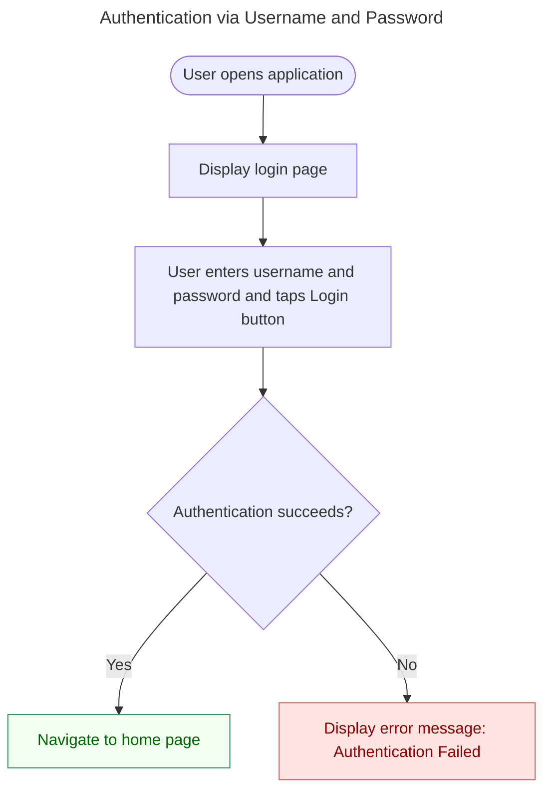

## Purpose

This document provides guidelines for creating flowcharts using Mermaid.

## Format

Before we go through the rules, it would be helpful to see an example:

As you can see, you must follow the following rules, at least:
- There is a title.
- Two spaces are used for indentation.
- The typical `End` node at the end is unnecessary.
- Color-code leaf nodes based on their success and failure results, as shown in the example.
