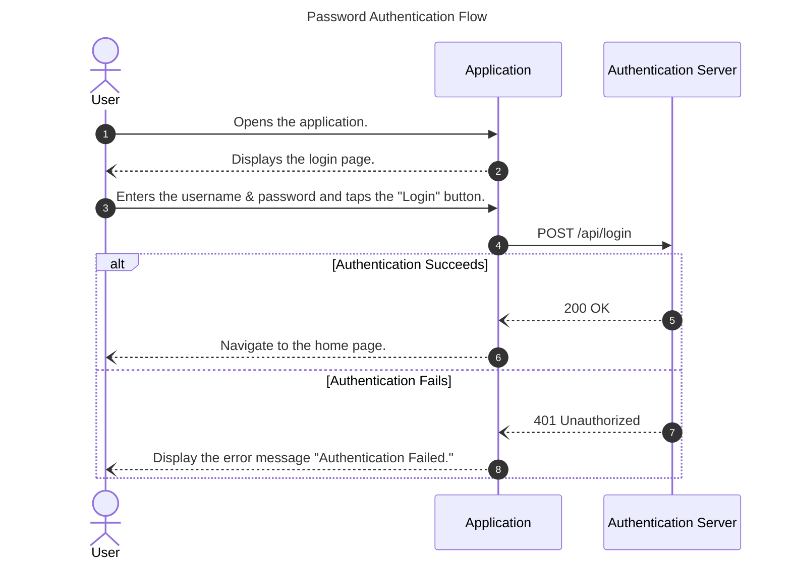

## Purpose

This document provides guidelines for creating sequence diagrams using Mermaid.

## Format

Before we go through the rules, it would be helpful to see an example:


As you can see, you must follow the following rules, at least:
- The `autonumber` is enabled.
- There is a title.
- Two spaces are used for indentation.
- Actors and participants are defined. \
   Variable names must be lowercase, and labels must be in title case. \
   Use camelCase for compound variable names.
- The message for a request must use the arrow `->>`, and the message for a response must use the arrow `--)`.
- The message for a request must have the corresponding response unless it's a one-way request that the sender doesn't expect any feedback.
- Only communication between participants is shown. \
   In other words, there must be no arrow pointing to itself because we are interested in knowing the communication among entities rather than each entity's internal logic.

## HTTP

As you saw in the example in the [Format](#format) section, you must follow these rules when it comes to HTTP:
- The HTTP request must be in the format of `METHOD /api/endpoint`.
- The HTTP response must be in the format of `HTTP_STATUS_CODE HTTP_STATUS_MESSAGE`.

Furthermore, you must create a reference document to explain the details of each HTTP request.

Each reference document's title must include the step number displayed in the sequence diagram.

For instance, I created a reference document [Step 4 - Authentication API](#step-4---authentication-api) for the example in the [Format](#format) section. Please follow that pattern.

Do not record sensitive information, such as passwords and tokens (use a dummy value or redact it).

### Step 4 - Authentication API

This is what the request would look like in curl:
```sh
% curl -i -X POST "https://api.example.com/api/login" \
  -H "Content-Type: application/json" \
  -d '{
    "username": "dummyName",
    "password": "dummyPassword"
  }'
```

The response would look like this if the request succeeded:
```http
HTTP/1.1 200 OK
Date: Thu, 29 Oct 2026 10:15:40 GMT
Content-Type: application/json; charset=utf-8
Content-Length: 142
Connection: keep-alive
Server: nginx

{
  "status": "success",
  "statusCode": 200,
  "message": "Authentication successful",
  "data": {
    "token": "eyJ..."
  }
}
```

The response would look like this if the request failed:
```http
HTTP/1.1 401 Unauthorized
Date: Thu, 29 Oct 2026 10:15:40 GMT
Content-Type: application/json; charset=utf-8
Content-Length: 142
Connection: keep-alive

{
  "status": "error",
  "statusCode": 401,
  "message": "Authentication failed"
}
```
